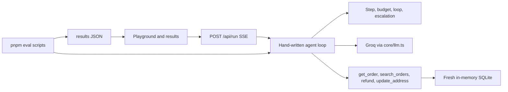

# Agent Reliability Lab

A support agent you can measure: guardrails, tool-path evals, and a single-agent versus multi-agent comparison, with every published number coming from a real eval file.

Deployed app: https://agent-reliability-lab-eosin.vercel.app/
Demo video: TODO(me)

## The three projects

**Guardrails.** A tool-using support agent can repeat the same search forever when a name is slightly wrong. This project adds a step limit, a cost budget, a loop detector, and a human ticket, then compares a 50-task run with those guards off and on.

**Trajectory eval and idempotent refunds.** A refund call can time out after the database write. The retry looks new, so the customer is refunded twice. This project scores the path of tool calls separately from the final database, then stores one idempotency key per user request so the retry returns the original refund.

**Single versus multi-agent.** The same harder tasks are solved by one agent and by a lead that delegates to lookup, refund, address, and summary workers. The comparison is success, cost, and latency, split by whether the subtasks are independent or dependent.

## Architecture



## Results

Numbers below are filled only from `results/*.json`. P2 and P3 stay as placeholders until those evals finish.

### P1 before / after

From `results/p1.json`, 50 tasks, `openai/gpt-oss-120b`. No guards-off run looped, so no loop trace was written.

| | Stuck rate | Avg steps | Avg cost |
|---|---|---|---|
| Guards off | 0% | 2.8 | $0.000305 |
| Guards on | 0% | 2.8 | $0.000307 |

### P2 before / after

| | Duplicate refunds | Strict tool accuracy | Outcome accuracy |
|---|---|---|---|
| Idempotency off | TODO(me) | TODO(me) | TODO(me) |
| Idempotency on | TODO(me) | TODO(me) | TODO(me) |

The interesting gap is when the outcome looks right and the tool path does not. That gap is computed on the results page from the same file.

### P3 single versus multi

| | Success | Cost | Latency |
|---|---|---|---|
| Single | TODO(me) | TODO(me) | TODO(me) |
| Multi | TODO(me) | TODO(me) | TODO(me) |

Decision rule: TODO(me). After `pnpm eval:p3`, this sentence is written into `results/p3.json` from the measured independent-task delta. Do not replace it with a guessed percentage.

## Traces

TODO(me): screenshot of a looping run from `results/traces/p1-loop-1.json`.
TODO(me): screenshot of a double refund from `results/traces/p2-double-refund.json`.

Those files are written by the eval scripts only when a run actually loops or double-refunds. They are not checked in as samples.

## Run locally

```bash
pnpm i
cp .env.example .env
```

Fill `GROQ_API_KEY` and the prices in `config/pricing.ts` (see https://console.groq.com/docs/models). Then:

```bash
pnpm dev
pnpm eval:baseline
pnpm eval:p1
pnpm eval:p2
pnpm eval:p3
```

Each eval prints a ceiling estimate and waits for you to type `yes`, or pass `--yes`. `--limit N` runs a cheaper slice. `--model` overrides `AGENT_MODEL`. Do not run the full evals on Vercel.

## Methodology and limitations

The eval sets are 50 and 30 hand-written tasks against 20 fixed orders. That is small enough for one person to audit and small enough that a few odd replies move the rate. Temperature is 0, and P3 still repeats trials because the model is not deterministic. The shop, the timeout, and the flaky search are simulated. Prices are whatever you enter for the selected Groq model, and the default model (`openai/gpt-oss-120b`) does not support parallel tool calls, so a turn usually contains one tool call.

## Resume lines

- Measured a support agent on 50 tasks with guardrails off and on: stuck rate stayed 0% (2.8 steps, about $0.0003 per task) because this model did not loop, so the guards did not have a stuck run to stop.
- Removed duplicate refunds on retry (TODO(me) down to TODO(me)) by keying each refund to the user request, and reported tool-path accuracy separately from answer accuracy (TODO(me) vs TODO(me)).
- Compared a single agent with an orchestrator-worker setup on 30 tasks and kept the single agent as the default unless independent subtasks improved success by more than TODO(me) at the measured extra cost.

## Deploy checklist

1. Create a Groq API key and set a monthly spend limit in the Groq console.
2. Push this repo to GitHub.
3. Fill `config/pricing.ts` with the current price per million tokens.
4. `pnpm eval:baseline` and `pnpm eval:p1` are done and committed. Run `pnpm eval:p2` and `pnpm eval:p3` next, then commit `results/`.
5. Import the GitHub repo in Vercel. The framework is Next.js.
6. Set `GROQ_API_KEY` and `AGENT_MODEL`. Optionally set `DEMO_PASSCODE`. Add Upstash Redis from the Vercel Marketplace if you want the rate limit to survive across instances.
7. Open `/playground`, run a preset, confirm the rate limit, then record the demo and replace the TODO(me) links and screenshots in this file.

Live runs are capped at 12 steps and $0.05 even if the toggles are off. Hobby Vercel plans may cut a function off at 10 seconds; `maxDuration` is set to 60 for Pro. Groq is fast, so a short preset usually finishes inside the hobby window.
